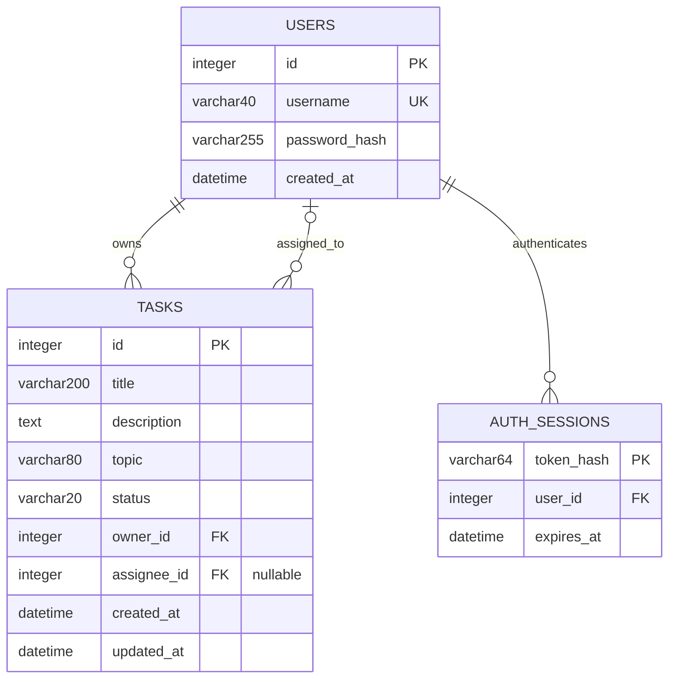

# Модель данных

## ERD

Один пользователь владеет 0..N задачами; у задачи ровно один владелец.
Один пользователь назначен на 0..N задач; у задачи 0..1 исполнитель.
Один пользователь имеет 0..N независимых сессий; каждая относится к одному пользователю.
Владелец и исполнитель могут совпадать. Тема - строковый атрибут задачи:
отдельный справочник не нужен, поскольку у темы нет собственных свойств и CRUD.

## Ограничения и значения

| Таблица | Правила |
|---|---|
| users | PK id, UNIQUE username; все поля NOT NULL; CHECK длины логина 3-40 |
| tasks | PK id; NOT NULL кроме assignee_id; CHECK статуса; CHECK длины непустого title 1-200 и topic 1-80 |
| auth_sessions | PK token_hash; NOT NULL user_id и expires_at; FK на users |

На уровне API логин приводится к нижнему регистру, содержит только `[a-z0-9_]`.
Пароль 10-128 символов. Описание максимум 10 000 символов. Пробелы по краям
заголовка и темы удаляются до сохранения. Начальный статус - `new`, описание -
пустая строка, тема - `Общее`, исполнитель - `NULL`. Эти значения назначает
приложение; INSERT напрямую в SQL должен явно задать обязательные значения.

Поля времени - UTC без tzinfo, включая ответы API; `updated_at` меняется на каждом
успешном PATCH. Хеш Argon2 включает параметры и соль. `token_hash` - SHA-256 от
случайного токена; исходный токен хранится только у клиента.

## Внешние ключи и удаление

| Ссылка | При удалении пользователя |
|---|---|
| tasks.owner_id → users.id | CASCADE: удалить его задачи |
| tasks.assignee_id → users.id | SET NULL: снять назначение с оставшихся задач |
| auth_sessions.user_id → users.id | CASCADE: удалить его сессии |

Удаление пользователя не входит в API выбранного варианта, но правила целостности
заданы в PostgreSQL и проверяются интеграционными тестами на PostgreSQL 16.
Внешние ключи действуют на уровне СУБД для всех подключений.

## Индексы

| Индекс | Назначение |
|---|---|
| UNIQUE users.username | Вход и уникальность логина |
| PK auth_sessions.token_hash | Поиск авторизации |
| auth_sessions.user_id | Поиск сессий пользователя / каскад |
| auth_sessions.expires_at | Будущая очистка истёкших сессий |
| tasks(owner_id, status) | Список владельца, фильтр статуса |
| tasks(owner_id, topic) | Точный фильтр темы |
| tasks(owner_id, assignee_id) | Фильтр исполнителя в задачах владельца |

Поиск `LIKE '%text%'` не ускоряется обычным B-tree индексом. Полнотекстовый поиск
не требуется для объёма учебного проекта. Данные не дублируются в отдельных
таблицах аналитики: pandas группирует актуальные строки текущего владельца.

## Миграция

`0001_initial.py` создаёт `users` → `auth_sessions` → `tasks`, затем индексы.
Downgrade удаляет таблицы в обратном порядке. Таблица `alembic_version` управляется
Alembic. Миграция не импортирует ORM-модели, поэтому изменение моделей в будущем
не изменит историческую схему. `alembic check` сверяет схему с актуальной metadata.

Все записи выполняются транзакционно. Например, назначение проверяется до
изменения полей задачи; при ошибке ни заголовок, ни исполнитель не меняются.
Уникальность логина дополнительно обеспечена БД, включая одновременные регистрации.
